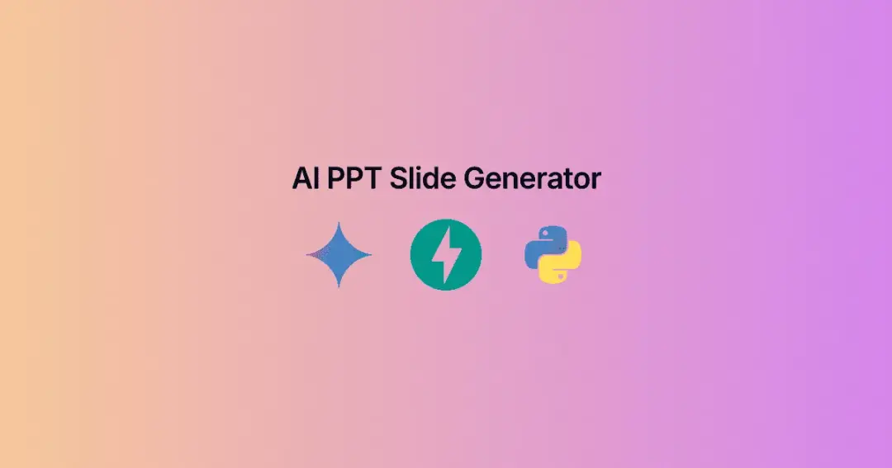

# AI PPT Generator

[](https://opensource.org/licenses/MIT)
[](https://www.python.org/)
[](https://fastapi.tiangolo.com/)
[](https://www.docker.com/)
[](https://www.postgresql.org/)
[](https://ysskrishna.space)

## Overview

PPT Generator is a backend API service that generates PowerPoint presentations (PPTX) using AI (Google Gemini) or custom user content. It allows users to create, configure, and download presentations programmatically, supporting custom slide layouts, fonts, and colors.



---

## Features
- **AI-powered slide generation**: Generate slide content automatically from a topic and slide count using Google Gemini.
- **Custom content**: Provide your own slide content and structure.
- **Configurable appearance**: Set fonts, font colors, and background colors for presentations.
- **Downloadable PPTX**: Download the generated presentation as a .pptx file.

---

## Architecture
- **Backend**: FastAPI (Python)
- **Database**: PostgreSQL (stores presentations and configurations)
- **AI Integration**: Google Gemini for content generation
- **PPTX Generation**: python-pptx
- **Containerization**: Docker & Docker Compose

---

## Setup & Installation

### Prerequisites
- Python 3.12+
- Docker & Docker Compose (recommended)
- Google Gemini API key

### Environment Variables
Create a `.env` file in the `backend/` directory with the following:
```
DATABASE_URL=postgresql://service_user:service_password@db:5432/presentation_db
GEMINI_API_KEY=your_gemini_api_key_here
```

### Running with Docker Compose
1. Build and start the services:
   ```sh
   docker-compose up --build
   ```
2. The API will be available at `http://localhost:8085`.

### Running Locally (without Docker)
1. Install dependencies:
   ```sh
   cd backend
   pip install -r requirements.txt
   ```
2. Ensure PostgreSQL is running and `DATABASE_URL` is set in `.env`.
3. Run the API:
   ```sh
   python main.py
   ```

---

## API Endpoints

### 1. Create a Presentation
- **POST** `/api/v1/presentations/`
- **Request Body:**
  ```json
  {
    "topic": "Artificial Intelligence",
    "num_slides": 5,
    "custom_content": [  // Optional, overrides AI generation
      {
        "layout": "title",
        "title": "Welcome to AI"
      },
      {
        "layout": "bullet",
        "title": "Key Points",
        "bullets": ["History", "Applications", "Future"]
      }
    ]
  }
  ```
- **Response:**
  ```json
  {
    "presentation_id": 1,
    "topic": "Artificial Intelligence",
    "content": [...],
    "configuration": null
  }
  ```

### 2. Configure a Presentation
- **POST** `/api/v1/presentations/{presentation_id}/configure`
- **Request Body:**
  ```json
  {
    "font_name": "Arial",
    "font_color": "#000000",
    "background_color": "#FFFFFF"
  }
  ```
- **Response:** Same as above, with updated `configuration`.

### 3. Get Presentation Details
- **GET** `/api/v1/presentations/{presentation_id}`
- **Response:** Presentation details (see above).

### 4. Download PPTX
- **GET** `/api/v1/presentations/{presentation_id}/download`
- **Response:** Returns the generated `.pptx` file.

---

## Contributing

Please read our [Contributing Guide](https://github.com/ysskrishna/ai-ppt-slide-generator/blob/main/CONTRIBUTING.md) for details on our code of conduct, development setup, and the process for submitting pull requests.

## Built and maintained by

AI PPT Generator is built and maintained by:

| | Name | GitHub | Role |
|---|------|--------|------|
|  | **Y. Siva Sai Krishna** | [@ysskrishna](https://github.com/ysskrishna) | Creator |

## Support

If you find this project helpful:

- ⭐ Star the repository
- 🐛 [Report issues](https://github.com/ysskrishna/ai-ppt-slide-generator/issues)
- 🔀 Submit pull requests
- 💝 [Sponsor on GitHub](https://github.com/sponsors/ysskrishna)

## License

MIT © [Y. Siva Sai Krishna](https://github.com/ysskrishna) — see [LICENSE](LICENSE) for details.

---

<p align="left">
  <a href="https://github.com/ysskrishna">Author's GitHub</a> •
  <a href="https://linkedin.com/in/ysskrishna">Author's LinkedIn</a> •
  <a href="https://ysskrishna.space">Author's site</a> •
  <a href="https://github.com/ysskrishna/ai-ppt-slide-generator/issues">Report Issues</a>
</p>
